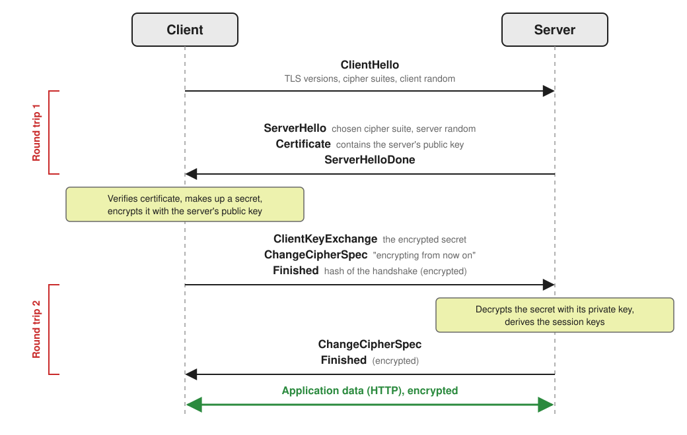
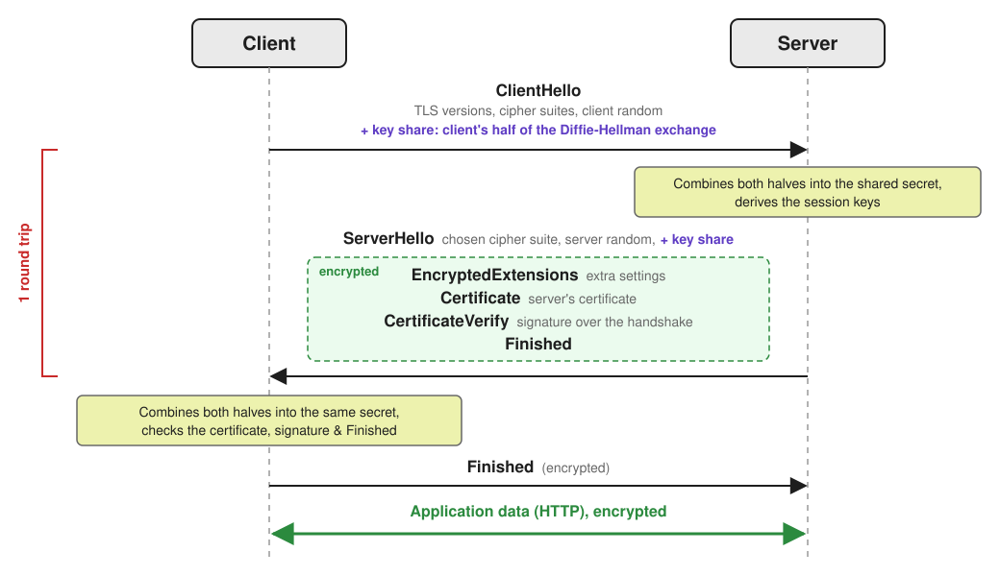
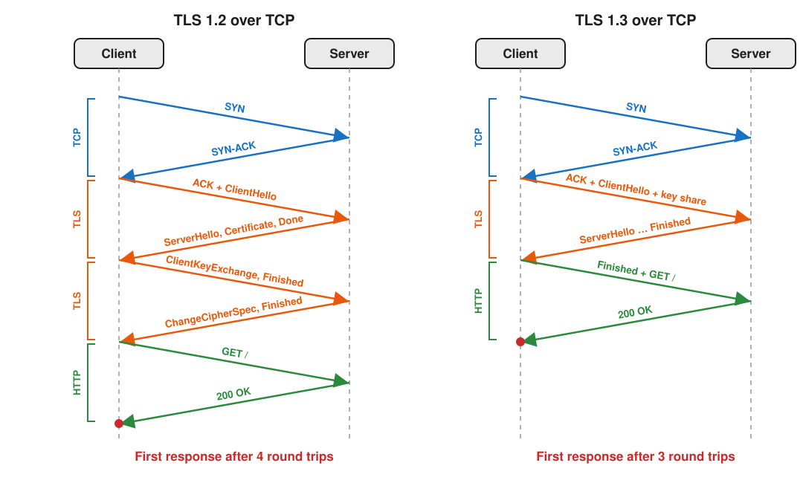
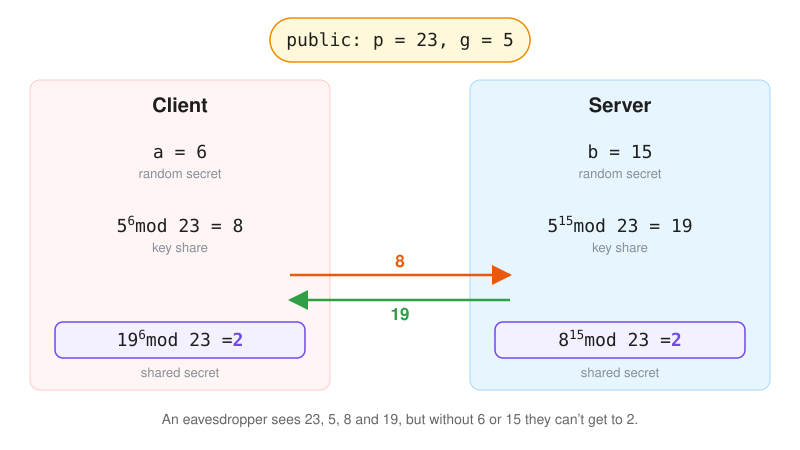
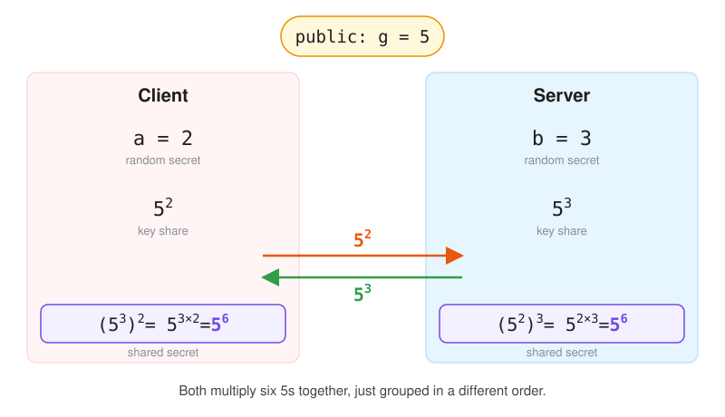

Every time you open a website, your browser and the server agree on a secret key in a fraction of a second, over a network where anyone could be listening. TLS 1.3 made that process faster and a lot harder to get wrong. Let's look at how it actually works under the hood, starting with how TLS 1.2 did it and why that wasn't good enough.

## What Is TLS? 
TLS stands for **Transport Layer Security** and it's what people talk about when they say SSL. **SSL** (Secure Sockets Layer) is the predecessor of TLS and has been **deprecated** for a long time. Perhaps most importantly, TLS is what puts the "Secure" in **HTTPS** (Hypertext Transfer Protocol Secure). HTTPS is just HTTP running on top of a secure TLS channel (in all but a few cases). 

## Where Does It Sit On The Stack? 
When making an HTTPS request, you're typically doing the following steps: 
1. Establishing a TCP connection. This is done via the **TCP handshake**. 
2. Establishing a TLS connection. This is done via the **TLS handshake**. 
3. Sending HTTP requests over that secure TLS channel. 

You can send multiple HTTP requests over the same TLS channel.

## TLS 1.2
To illustrate the advantages of TLS 1.3, I'll first talk about how TLS 1.2 works. 

The whole goal of the TLS handshake is for the client and server to agree on a shared and mutually understood way of encrypting and decrypting data. The difficulty is that they need to do that over a network where anyone could be listening in. 

For simplicity, I'll only walk through the regular client-server case where only the server authenticates itself. There's also **mutual TLS**, where both the client and the server authenticate themselves, typically used for server-to-server communication. 

There are a few ways TLS 1.2 can do this. I'll use the classic one as an example: the **RSA key exchange**, which was the most common option for a long time. It's been phased out for a while now, but it's how most connections worked 10+ years ago. TLS 1.2 can also do a Diffie-Hellman key exchange, but I'll save that for the TLS 1.3 section. 

Here's how it goes:
1. **The client says hello.** It tells the server which TLS versions and which **cipher suites** it supports. A cipher suite is just a combo of algorithms: one for agreeing on a key, one for proving the server's identity, one for encrypting the data, and one for checking that nothing was tampered with. It also sends a random number. This one isn't secret, but it gets mixed into the encryption keys later, so that every connection ends up with brand-new keys, even if someone tries to replay an old conversation.
2. **The server answers.** It picks one of the cipher suites from the list, sends its own random number, and sends its **certificate**. I won't go into too much detail about how certificates work, but basically the certificate is vouched for by a trusted authority and it contains the server's **public key**. That public key can be used to encrypt stuff which only the private key (held by the server and the server alone) can decrypt. 
3. **The client creates the secret.** It checks that the certificate is legit, then makes up a random secret. It encrypts it with the server's public key and sends it over. The server decrypts it with its private key, and now both sides know the same secret. Each of them then mixes it with the two random numbers from earlier to get the actual encryption keys (one for each direction, so the client and server each encrypt with their own, but both know both).
4. **Both sides wrap up.** Each one says "from now on, everything I send is encrypted" and then sends an encrypted **Finished** message, which is a summary of everything said during the handshake. If someone tampered with any of the earlier messages, the summaries won't match and the connection gets dropped.

**Asymmetric encryption** (like RSA) is typically only used to do the first part of the handshake. The actual encryption used for the connection uses **symmetric encryption**, which is much faster.

Only after all of this can the browser send its first HTTP request. That's **2 round trips** just for TLS, on top of the 1 round trip for the TCP handshake. 

There's also a nasty problem with the RSA key exchange: **everything depends on the server's private key**. If someone records your encrypted traffic today and manages to steal that key years from now, they can decrypt every secret they recorded, and with them all of your old conversations. The way around this is called **forward secrecy**. TLS 1.2 could already give you forward secrecy if you picked a Diffie-Hellman key exchange instead of RSA, but it was **optional**. TLS 1.3 makes it **mandatory**.

## What TLS 1.3 Brings To The Table
TLS 1.3 isn't just TLS 1.2 with a few tweaks. A lot of things were thrown out, and what's left is both faster and much harder to misconfigure. The big changes: 
- **Forward secrecy is mandatory for full handshakes.** With TLS 1.2 and RSA, someone who recorded your traffic and later stole the server's private key could decrypt all of it. TLS 1.3 only allows key exchanges where that's impossible (more on that below).
- **Lots of old stuff is gone.** RSA key exchange, outdated algorithms like MD5, SHA-1 and RC4, and a bunch of risky features were all removed. There are only a handful of cipher suites left, and all but one of them are considered secure (`TLS_AES_128_CCM_8_SHA256` is marked as not recommended). They're also simpler: a TLS 1.3 cipher suite only picks the encryption algorithm and the hash. The key exchange is always Diffie-Hellman, so there's nothing left to choose there, and the signature algorithm is agreed on separately.
- **The handshake takes 1 round trip instead of 2.**
- **More of the handshake is encrypted.** Everything after the ServerHello is encrypted, including the server's certificate, so someone watching the network can no longer see it.
- **0-RTT mode.** When you reconnect to a server you've talked to before, the client can send its first request right away, with zero extra round trips. The catch is that an attacker can replay that early data, so it should only be used for safe requests (like a plain GET).

## The TLS 1.3 Handshake

Notice how the client sends its **key share** in its first message, alongside the ClientHello. This is one of the most important changes to TLS 1.3. Given that there are only a few options for the key exchange (and almost everyone supports the same one or two), the client just **guesses** which one the server will pick and sends its key share for it. In the unlikely event that the guess is wrong, the server replies with a **HelloRetryRequest** asking for a different key share, and the handshake takes 2 round trips, just like TLS 1.2. 

`TLS_AES_128_GCM_SHA256` is what a cipher suite looks like: 128-bit AES-GCM for encryption (which also detects tampering) and SHA-256 for deriving the keys and hashing the handshake messages. The key exchange is always a Diffie-Hellman exchange: the client lists the flavours it supports in the ClientHello and the server picks one in the ServerHello. The signatures are one of ECDSA, RSA-PSS or Ed25519. 

The certificate's key is **no longer used to encrypt anything, only to sign**. So how does the server prove it actually owns the certificate? Right after the certificate, it sends a **CertificateVerify** message: a signature, made with its private key, over a hash of every handshake message so far. The client checks it using the public key from the certificate. Only the real server could have produced that signature, and since it covers the whole handshake (including both key shares), nobody in the middle can swap anything out. 

The keen-eyed among you may notice by now that this doesn't exactly look like a single round trip. There are three messages: the ClientHello, the server's reply (ServerHello all the way to Finished) and the client's Finished. The trick is that the client **doesn't have to wait for anything** after sending its Finished, so it doesn't cost an extra round trip. This makes more sense if you put it into the context of the entire request. 

Now here's where the single round trip comes from: the client's Finished is sent **together with the HTTP request**. The only time the client actually waits on TLS is between sending the ClientHello and getting the server's reply. Add the TCP handshake in front, and the first response arrives after **3 round trips instead of 4**. 

## The HTTP/3 Caveat
[As I've previously discussed](https://alexgherghe.com/posts/http-3-is-quic/), HTTP/3 let go of TCP. It runs on top of QUIC, which runs on top of UDP and uses TLS 1.3 for its handshake.
Ok, this is a mouthful, so what does this mean? 
HTTP/3 does not use TCP. It uses **QUIC** instead. QUIC is built on top of UDP and gives you all of the guarantees (reliability, ordering, congestion control, encryption) that you'd want from a transport protocol. 
In QUIC, TLS is a first-class citizen. It is no longer optional: it is built into the transport protocol. QUIC takes the TLS 1.3 handshake, but encrypts its packets itself instead of using TLS records. This enables us to do some cool things, like **merging the transport protocol handshake and the TLS handshake**. So, with HTTP/3, the separate TCP round trip from the diagram above disappears, and there is **no additional TLS-caused RTT** (round-trip time).

## Diffie-Hellman

So what is Diffie-Hellman and how does it work? Forward secrecy needs an **ephemeral** key (one that's generated fresh for every connection and thrown away afterwards). Diffie-Hellman is an algorithm that allows us to generate such a key.

It allows us to exchange a few numbers over the network **in plain sight** and still end up with **the same secret**.
In the original version of Diffie-Hellman, both sides agree on two public numbers: a large prime **p** and a base **g**. In TLS 1.3 these aren't even sent over the network: they're **fixed by the standard**, and the client and server just agree on which set to use by name (like "x25519" or "ffdhe2048") in the ClientHello and ServerHello. TLS 1.2 used to allow you to pick p and g of your own accord (as long as they were agreed on by both parties, of course), but it turns out that creating groups that are actually secure is not that simple. 

The client picks a secret number **a** and sends **A = ga mod p**. The server picks a random secret **b** and sends **B = gb mod p**. These are the **key shares**. The client then computes **Ba mod p** and the server computes **Ab mod p**, and because of how exponents work, both of these are equal to **gab mod p**. That's the **shared secret**.

In the figure above, it's easier to tell why both sides end up with the same number. So why do we need the prime at all? Without it, A would just be a huge power of g, and anyone could work out a with a regular logarithm. Taking the remainder after dividing by p makes the numbers **wrap around**, which throws away exactly the information you'd need to go backwards. The prime has to be large so there's a huge pool of possible values, and together with a well-chosen base, it makes sure the results don't start repeating too early (which would make guessing a lot easier). 

An eavesdropper sees p, g, A and B. To get the secret, they'd need to work out a from A (or b from B), which means finding which power of g gives A once you take the remainder. This is called the **discrete logarithm problem**, and with a 2048-bit prime there's no known way to do it in any reasonable amount of time (at least on regular computers).

In practice, TLS 1.3 almost always uses the **elliptic curve** version of Diffie-Hellman (that's the "EC" in ECDHE). Reversing that is the elliptic curve discrete logarithm problem, which is even harder, so much smaller numbers give the same security. A **256-bit elliptic curve key is roughly as strong as a 3072-bit classic one**, which makes everything faster and keeps the key shares small. 

There's one big asterisk, though: a large enough **quantum computer** could solve both versions of the discrete logarithm problem. Nobody has one yet, but remember the problem with someone recording your traffic today and decrypting it years later? That's exactly the worry here. This is why most browsers now default to a **post-quantum hybrid** key exchange called X25519MLKEM768: a regular X25519 key share plus one from ML-KEM, an algorithm designed to hold up against quantum computers. The two secrets are combined, so an attacker would have to **break both**. 

## Multiple Keys

The shared secret **isn't used to encrypt anything directly**. Both sides feed it, together with a hash of all the handshake messages so far (which includes the two random numbers), into a key derivation function (HKDF). 

That function produces a whole family of keys, each with its own job:
- **Handshake keys**: used to encrypt the rest of the handshake (this is why the server's certificate can already be encrypted).
- **Finished keys**: used to compute the MAC (a keyed checksum) in the Finished messages, proving both sides saw the same handshake.
- **Application keys**: used to encrypt the actual HTTP traffic. These can be refreshed during a long connection with a KeyUpdate message.
- **Resumption secret**: used to create a session ticket, so the next connection to the same server can skip parts of the handshake (and use 0-RTT).

Like in TLS 1.2, there's a separate key for each direction: the client encrypts with its own, the server with its own.

## AEAD

In older TLS versions, encryption and integrity checks were handled separately, which caused a long history of nasty padding attacks. 

TLS 1.3 fixes this by making **AEAD** (Authenticated Encryption with Associated Data) mandatory. Algorithms like **AES-GCM** and **ChaCha20-Poly1305** encrypt and authenticate data in a single step. If someone tampers with even a single bit in transit, the authentication tag fails and the packet is dropped immediately.

## 0-RTT

If you've talked to a server before, you already have a **session ticket** from it. On the next connection, the client can use that ticket to derive keys straight away and send its first HTTP request **together with the ClientHello**, without waiting for the server at all. That's zero extra round trips for TLS.

There's a catch, though. That early data is encrypted with keys that come from the ticket, not from a fresh Diffie-Hellman exchange, so it **doesn't get the same protection** as the rest of the connection. Most importantly, an attacker can record it and **replay** it to the server, so be aware of these security implications when using 0-RTT.

## Some Takeaways

TLS 1.3 is what TLS 1.2 would look like if you could start over with everything learned in the meantime:
- **It's faster**: one round trip for the handshake instead of two, or even zero when reconnecting.
- **It's safer by default**: forward secrecy is mandatory, and all the old, risky options are gone, so there's much less room for misconfiguration.
- **It's more private**: most of the handshake, including the server's certificate, is encrypted.

The best part is that you most likely **don't have to do anything** to get these benefits. Every modern browser and most servers already support TLS 1.3, so chances are you're using it to read this very article.

We've barely even scratched the surface here. This is a very large topic, so be sure to check out the [RFC](https://www.rfc-editor.org/info/rfc9846) (RFC 9846, which replaced the original TLS 1.3 RFC 8446) if you want a more in-depth look. But beware, it is not exactly what I would call a pleasant read. It is very long and full of cryptographic jargon. 
